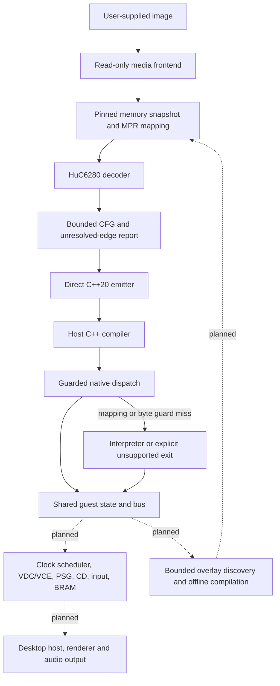

# Baseline architecture

This document describes both the implemented foundation and the contracts
for later subsystems. **Only components marked implemented exist today.**
The runtime is currently a CPU analysis sandbox, not a complete console.

## Execution model



The compiler translates guest CPU operations; it does not remove the need
to model video, audio, CD, interrupts, and their timing. The target is a
static-first hybrid framework: ahead-of-time code where its identity and
semantics are established, an accurate interpreter for unseen code, and
optional native service/presentation replacements with explicit contracts.
The initial interpreter is partial and cannot yet supply that complete
correctness floor.

There is no LLVM backend dependency. C++ output gives contributors readable
translations, ordinary compiler diagnostics, and portable host optimization.
An optimizing block IR/backend can follow measured needs without replacing
media, analysis, bus, or validation interfaces.

## Source identity and address translation

The HuC6280 has a 16-bit logical PC and eight MPRs mapping 8 KiB pages into
a 21-bit physical space:

```text
physical = (MPR[logical >> 13] << 13) | (logical & 0x1fff)
```

The decoder translates **each fetched byte** independently, including fetches
that cross an MPR page or wrap from `$FFFF` to `$0000`. Zero-page operands
refer to logical `$2000..$20FF`; stack accesses use `$2100..$21FF`. They are
not ordinary 6502 `$0000` and `$0100` accesses.

**Implemented dispatch identity:** logical PC, the complete MPR snapshot,
and exact instruction bytes at their recorded physical locations. Generated
code checks mapping and bytes on every step, then executes literal C++
operations. A guard miss returns to the dispatcher before modifying state.
Source peeks never read MMIO devices. This deliberately conservative design
supports one mapping context per generated module.

RAM writes and loader writes also advance per-bank generations. The initial
dispatcher does not use generations as a shortcut: byte checks remain the
authority. Future block-level guards must invalidate aliases and exit on a
write that can change a later instruction in the active block. A different
overlay occupying the same bank and logical PC is a different translation.

**Planned cache identity:** source content digest, load/relocation recipe,
relevant MPRs, entry offset, generator revision, runtime ABI, compiler/options,
and host target architecture. A DLL filename or PC alone will never identify
a trustworthy cache entry. Runtime-loaded modules and persistent caches are
not implemented yet.

## Compiler frontend and IR

| Component | Current contract |
|---|---|
| `media.py` | CHDv5 metadata, bounded hunk reads, MODE1/RAW user sectors, ISO and supported IPL extraction |
| `analysis.Snapshot` | Explicit MPRs, physical byte ranges, entry points and per-segment SHA256 pins |
| `isa.py` | 256 explicit encoding slots; decoded length, physical fetch locations, mode and direct target |
| `analysis.analyze` | Instruction graph, typed edges, conservative TAM barrier and bounded unresolved work |
| `emitter.py` | Direct translated C++ for supported instructions; per-step guards and ABI assertion |

Snapshot schema 1 is TOML. Analysis schema 1 is JSON and is an inspection
format, not yet a stable external plugin API. Branches retain both edges.
Calls retain callee and return-site edges; this is code-discovery evidence,
not proof that a callee returns. Indirect jumps, stack returns, interrupts,
missing bytes, mapping changes, unassigned opcodes and instruction limits
stay explicit. Overlapping instruction interpretations block native emission.

TAM stops static discovery in the current mapping. Runtime execution can
perform supported TAM and return with updated MPRs. Constant propagation,
multi-context CFGs, jump-table annotations and trace-assisted discoveries
are subsequent stages. Never scan every disc byte as presumed executable
code or invent indirect targets to inflate coverage.

## Runtime boundary

`Cpu` owns registers, flags, logical PC, MPRs, the dedicated TAM/TMA transfer
latch, simulated cycle/tick counts and separate execution counters.
`Bus` owns physical storage, bank kinds and
write generations. Guest calls use the guest stack; they are not blindly
replaced by host calls. This preserves stack manipulation and observable
return addresses when future instructions are added.

RMB/SMB, all eight push/pop instructions and every encoding of the supported
load/store/logical/arithmetic/comparison, shift/rotate, INC/DEC and indirect
JMP families, bit-test/bit-branch operations, BSR and TAM/TMA have explicit
[CPU contracts](CPU_SEMANTICS.md), including PHP/PLP status, T-mode memory
destinations, decimal flags and pointer wrapping. These operations retain
the normal per-step source and mapping guards.
Indirect JMP resolves its current pointer at execution time; analysis keeps
its edge unresolved and makes no speculative claim about the destination.
The transfer latch persists through ordinary bus traffic; general I/O open-bus
state is separate and remains unimplemented. The latch first required ABI 2;
the current ABI is 3 because `Bus` now owns CD-control state. Regenerate old
modules and rebuild consumers together.
TAM retires before any changed mapping causes the next native guard to yield.

The sandbox maps explicitly selected RAM and treats unsupported device,
unmapped and ROM-write accesses as faults. It does not currently model PC Engine RAM
mirrors or HuCard mappers. A [limited idle CD-control profile](CD_CONTROL.md)
implements BRAM locking and exactly its listed control registers, with volatile
2 KiB BRAM and protected/upper-hole semantics. All routing uses the translated
physical bank. `read` now permits device side effects; `peek` remains pure and
refuses both I/O and BRAM source fetches. The headless loader can
explicitly map a supplied raw 256 KiB System Card ROM at physical banks
`$00..$1F`; these banks reject writes. Supplying that ROM enables the limited
CD profile; this is not a complete System Card or console boot profile.

Execution returns `executed`, `miss`, `unsupported` or `budget`. `step`
tries generated code, records a miss, then optionally interprets the current
bytes. Unsupported instructions do not retire. Bus faults terminate the
run and are not resumable transactional exceptions. The headless runner
requires explicit step and tick budgets and writes no saves or settings.

**Timing limit:** the current deadline prevents starting another instruction
once reached; the last instruction may cross it. Cycle totals are
instruction-level sandbox accounting, not bus-phase or IRQ accuracy.
CSL/CSH select low/high divisors 12/3. Their first two cycles use entry speed,
and the final cycle uses selected speed. Subsequent instructions consume the
live divisor, including generated code. `retire_speed` accounts for this
transition and increments exactly one instruction counter. Deadline checks
remain at instruction entry; a transition can cross the deadline completely.
The speed batch needed no extra divisor state. Clock alignment, dummy bus
phases, wait states, timer and interrupt delivery remain unimplemented.
No device is silently advanced as though it worked.

## Media and boot boundary

CHD track padding, stored pregaps, virtual pregaps and disc time are separate
coordinates. Each CHD track is padded to four frames. MODE1 raw data starts
after its sync/address/mode header; the compressed hunk layout also includes
subcode space. libchdr performs decompression; this project does not implement
its own CHD codecs. Header SHA1 values are reported as claims, not verified
checksums. A requested file SHA256 hashes the actual compressed input.

The current boot path supports a single MODE1 data track (with other audio
tracks allowed), or a single-track 2048-byte ISO. It reads the IPL header in
the second data sector and treats boot-file sector fields as relative to
that data track for the supported path. This was verified on the local Ys
III input. Multi-data-track discs and other IPL coordinate variants require
an explicit profile and are not claimed supported.

The extractor rejects embedded zero-sector IPL programs, nonzero opening
modes, unsupported MPR offsets and programs crossing loader/BIOS regions.
It captures the supported initial payload, not a post-BIOS execution state.
The MPR7 System Card mapping is an explicit assumption; an optional supplied
ROM now permits bounded firmware execution. Initial BIOS work-RAM values and
BIOS initialization are not reconstructed. See [FIRMWARE.md](FIRMWARE.md).

## Planned hardware/runtime modules

| Module | Owns | Required proof before game claims |
|---|---|---|
| Scheduler / IRQ | Master clock, speed changes, CPU events, timer, interrupt priority and acknowledgement | Boundary and priority tests against an independent reference |
| Video | HuC6270 VDC, HuC6260 VCE, VRAM, SATB, raster events, DMA and palette | Software reference frames, scanline effects, DMA/IRQ timing |
| Sound | Six-channel PSG, DDA/noise/LFO, ADPCM and CDDA transport/mixing | Sample/event comparison, seek/pause/end/fade and underrun tests |
| CD | Disc identity/TOC, command handshake, data transfer, seek timing and overlays | Trace parity for real command sequences and failed reads |
| Input | Two/six-button pads, multitap and deterministic input sampling | Protocol tests and real controller checks |
| Persistence | BRAM contents, namespaces, atomic writes and migration | Save/load, damaged files and isolated profile tests |
| Host | SDL-class window/input/audio backend, frame pacing and settings | Windows/Linux/macOS real output, resize/fullscreen and device tests |

System Card ROM loading and limited real firmware execution are implemented;
the complete RAM/device/boot profile remains planned. A later optional HLE service layer needs documented
flags, stack, timing, memory writes and error behavior. An experimental open
replacement project is listed in the research register; it is not bundled
or assumed to provide compatible firmware services.

## Enhancement and state contracts

Widescreen requires renderer visibility, world streaming, camera behavior,
HUD anchoring and scene exceptions. High-refresh output interpolates
presentation while preserving original simulation timing unless a separately
qualified game mod intentionally changes it. Neither is a compiler flag that
makes arbitrary games correct.

Future mod packages declare a stable ID, exact input identities, dependency
and conflict constraints, expected-byte patches, owned resources and save
compatibility. Native hooks need guards and a reference route. Co-op and
netplay require game-specific authority/state work; rollback also needs
deterministic simulation, captured inputs and complete device/CD state.

State snapshots will include a schema, runtime ABI, game/firmware identity,
enabled mods, mapping, MPR transfer latch, CPU/device clocks, pending events,
CD control/position and BRAM contents/protection. Restore rebuilds derived native registrations and renderer/audio
caches. Native pointers, host GPU handles and stale DLL registrations must
not be serialized. Save states, rewind and rollback are not implemented.

## Validation and optimization order

1. Independently expected synthetic CPU/media facts.
2. Native/interpreter state and memory comparisons.
3. Independently developed emulator CPU/bus/device traces.
4. Frame/audio/input comparisons for bounded deterministic routes.
5. Real gameplay, save/load, repeated scene transitions and campaign routes.
6. Matched performance measurements, then safe block fusion and caching.

The first two levels exist in the baseline. An optional Geargrafx MCP adapter
also compares single-step registers and work RAM against an independent
emulator. A bounded speed adapter compares CPU-entry timestamp deltas and
explicitly reports Geargrafx's different transition rule; device traces and
full cycle parity remain open. The current dispatch favors auditability
and mutation safety; it is not an optimized endpoint or a speedup claim.
