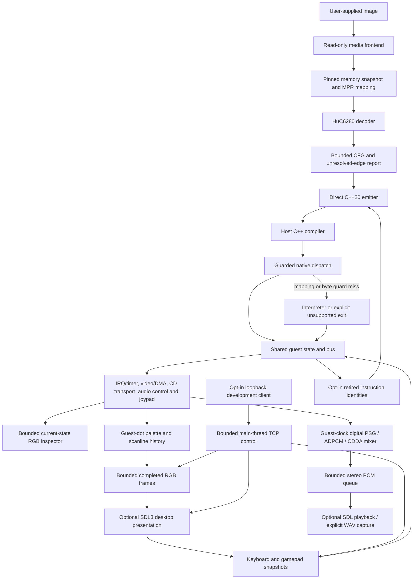

# Baseline architecture

This document describes both the implemented foundation and the contracts
for later subsystems. **Only components marked implemented exist today.**
The implemented runtime models part of the PC Engine/CD hardware and offers
headless and optional desktop hosts. Complete console compatibility remains
unqualified.

## Execution model



The compiler translates guest CPU operations; it does not remove the need
to model video, audio, CD, interrupts, and their timing. The target is a
static-first hybrid framework: ahead-of-time code where its identity and
semantics are established, an accurate interpreter for unseen code, and
optional native service/presentation replacements with explicit contracts.
The initial interpreter is partial and cannot yet supply that complete
correctness floor.

There is no LLVM backend dependency. C++ output gives contributors readable
translations, ordinary compiler diagnostics, and portable host optimization.
An optimizing block IR/backend can follow measured needs without replacing
media, analysis, bus, or validation interfaces.

## Cartridge and System Card startup

ABI 18 adds an explicit base HuCard profile and ROM-bank map to the bus.
`--hucard-reset base ROM STEPS TICKS tier` decodes only the declared header and
byte order, configures ROM/WRAM/base devices without CD/ADPCM/BRAM, then reads
the actual cartridge vector. Selected mirrors resolve storage while source
identities retain original physical addresses. No mapper or region is inferred
from a game checksum. See [HUCARD.md](HUCARD.md) for the compatibility map,
consumer recipe and unsupported boards. Existing System Card startup remains
a separate recipe with its original initialization contract.

The snapshot/IPL runner and reset-vector boot are distinct entry recipes.
`--system-card-reset standard|super BIOS STEPS TICKS tier` maps an explicitly
selected System Card, configures devices, attaches read-only media/BRAM inputs,
then starts the CPU through the actual ROM reset vector. It supplies no game
payload or guessed firmware service. Consumer schema-1 `[boot]` is mutually
exclusive with `[payload]`; both retain exact module/tool/input pins.

The memory profile mirrors 256 KiB ROM across cartridge banks, overlays
192 KiB RAM only for Super hardware, supplies 64 KiB CD RAM and base work-RAM
aliases, and preserves original mapped source identities. A one-shot startup
API requires pristine setup and zero device clocks. The host's deterministic
zero-seed policy is explicit; undefined hardware state, reset-pin phases and
warm reset are not inferred. BRAM is blank/unformatted or an explicit seed,
never automatically formatted. See [SYSTEM_CARD_BOOT.md](SYSTEM_CARD_BOOT.md).

## Source identity and address translation

The HuC6280 has a 16-bit logical PC and eight MPRs mapping 8 KiB pages into
a 21-bit physical space:

```text
physical = (MPR[logical >> 13] << 13) | (logical & 0x1fff)
```

The decoder translates **each fetched byte** independently, including fetches
that cross an MPR page or wrap from `$FFFF` to `$0000`. Zero-page operands
refer to logical `$2000..$20FF`; stack accesses use `$2100..$21FF`. They are
not ordinary 6502 `$0000` and `$0100` accesses.

**Implemented dispatch identity:** logical PC, the complete MPR snapshot,
and exact instruction bytes at their recorded physical locations. Generated
code checks mapping and bytes on every step, then executes literal C++
operations. A guard miss returns to the dispatcher before modifying state.
Source peeks never read MMIO devices. This deliberately conservative design
supports one mapping context for CFG-derived modules. Observed-code modules
support multiple complete MPR contexts and exact byte variants at the same
logical PC. Context dispatch packs all eight MPRs, then selects a logical page
and partition. Within a PC, one pure opcode peek chooses the instruction
length; each operand byte is peeked once and packed into an injective key of
at most 48 bits. The exact key selects translated operations, sharing identical
bodies where their retirement is also identical. Unknown or unreadable bytes
miss before `begin_instruction`; no guard miss mutates guest state.

Observed modules default to a 256-identity partition target. All variants at
one logical PC stay together, so an individual group can exceed the target.
The entry source dispatches to independently compiled parts through a generated
header; it never includes another `.cpp`. CMake pools a module object library
by canonical entry/manifest path, allowing both hosts to share one compile.
The manifest pins every translation unit and generated header. The consumer
interface verifies these files in build/run bindings, and CMake rechecks their
hashes on configuration and tracks them as configuration dependencies.
Legacy single-source manifests remain accepted. Source/runtime rebuilds are
required after a tool update; current ABI 18 does not accept ABI-12/13/14/15/16/17 binary objects.

RAM writes and loader writes also advance per-bank generations. The initial
dispatcher does not use generations as a shortcut: byte checks remain the
authority. Future block-level guards must invalidate aliases and exit on a
write that can change a later instruction in the active block. A different
overlay occupying the same bank and logical PC is a different translation.

**Planned cache identity:** source content digest, load/relocation recipe,
relevant MPRs, entry offset, generator revision, runtime ABI, compiler/options,
and host target architecture. A DLL filename or PC alone will never identify
a trustworthy cache entry. Runtime-loaded modules and persistent caches are
not implemented yet.

## Compiler frontend and IR

| Component | Current contract |
|---|---|
| `media.py` | CHDv5 metadata, bounded hunk reads, MODE1/RAW user sectors, ISO and supported IPL extraction |
| `cue.py` | Bounded BIN/CUE layout, MODE1/AUDIO reads, component pins and complete-image identity |
| `cartridge.py` | Explicit base HuCard input decoding, ROM mirror map and reset-vector source snapshot |
| `analysis.Snapshot` | Explicit MPRs, physical byte ranges, entry points and per-segment SHA256 pins |
| `isa.py` | 256 explicit encoding slots; decoded length, physical fetch locations, mode and direct target |
| `analysis.analyze` | Instruction graph, typed edges, conservative TAM barrier and bounded unresolved work |
| `emitter.py` | Direct translated C++ for supported instructions; per-step guards and ABI assertion |

Snapshot schema 1 is TOML. Analysis schema 1 is JSON and is an inspection
format, not yet a stable external plugin API. Branches retain both edges.
Calls retain callee and return-site edges; this is code-discovery evidence,
not proof that a callee returns. Indirect jumps, stack returns, interrupts,
missing bytes, mapping changes, unassigned opcodes and instruction limits
stay explicit. Overlapping instruction interpretations block native emission.
That restriction belongs to speculative CFG discovery. An observed-code module
may retain overlapping interpretations that each actually retired, guarded
independently; it infers no intervening control-flow edges.

TAM stops static discovery in the current mapping. Runtime execution can
perform supported TAM and return with updated MPRs. Constant propagation,
multi-context CFGs and jump-table annotations remain subsequent stages.
An opt-in observer now records bounded retired identities with native/interpreted
hit counts for offline direct translation; see [CODE_CAPTURE.md](CODE_CAPTURE.md).
Capacity loss and unreadable source are explicit. Captures contain code bytes
and stay private, including firmware observations. Never scan every disc byte as presumed executable
code or invent indirect targets to inflate coverage.

## Consumer interface

Consumer TOML schema 1 pins ABI 18, a complete tool revision and exact relevant
source-tree digest, module source/manifest hashes, input hashes, the initial
load/MPR recipe and explicit runtime profiles and execution limits.
`python -m pcerecomp.project` verifies these identities, builds through
`pce_add_consumer` and records the actual native/interpreted work and host result.
Build and execution receipts are separate; changed source, inputs, executables
or packaged dependencies invalidate a retained build. A revision override never
overrides source bytes. No dependency download, copied runtime or save write is
implicit. The shared host retains the `pce-dev-1` frame/input interface.
An authored example needs no game data. See [CONSUMER.md](CONSUMER.md).

## Runtime boundary

`Cpu` owns registers, flags, logical PC, MPRs, the dedicated TAM/TMA transfer
latch, simulated cycle/tick counts and separate execution counters.
`Bus` owns physical storage, bank kinds and
write generations. Guest calls use the guest stack; they are not blindly
replaced by host calls. This preserves stack manipulation and observable
return addresses when future instructions are added.

RMB/SMB, all eight push/pop instructions and every encoding of the supported
load/store/logical/arithmetic/comparison, shift/rotate, INC/DEC and indirect
JMP families, all five block transfers, bit-test/bit-branch operations, RTI,
IRQ entry, BSR and TAM/TMA have explicit
[CPU contracts](CPU_SEMANTICS.md), including PHP/PLP status, T-mode memory
destinations, decimal flags and pointer wrapping. These operations retain
the normal per-step source and mapping guards.
Indirect JMP resolves its current pointer at execution time; analysis keeps
its edge unresolved and makes no speculative claim about the destination.
The transfer latch persists through ordinary bus traffic; general I/O open-bus
state is separate and retained by the IRQ/PSG profile. The latch first required ABI 2;
ABI 13 added digital synthesis, decoder and bounded audio-output state.
ABI 14 additionally stores each PSG channel's held DAC output. ABI 15 owns
the guest CDDA source and sample latch. ABI 12 added continuous video.
The bus owns IRQ/timer state, palette/DMA,
PSG/ADPCM/CDDA functional state, controller types, sampled buttons,
SEL/CLR, tap slot, extra bank and output latch, alongside CD TOC metadata,
bounded sector responses, provider ownership, independent load deadlines,
auto-ACK, synchronized video and clocked transport. CPU state also records
completed native/interpreted block instructions and their payload bytes; the
bus supplies explicit block-aware accesses and non-retiring clock progress.
Regenerate old modules and rebuild consumers together.
TAM retires before the next dispatch uses the updated mapping. A captured
matching context may continue natively; an unmatched context yields before
guest mutation.

Block transfers execute one bounded instruction (at most 65,536 bytes), with
startup, six-cycle byte chunks and closing clocks synchronized to devices.
Deadlines are checked before effects; a started block finishes even if it
crosses the deadline. IRQ levels accumulate during the copy and are checked
at the completed transfer boundary, where IRQ delivery may enter a handler.
There is no suspended partial-block state. Fatal bus faults may leave partial
writes/clocks/stack effects and must not be retried in place. Generated modules
emit their own loops, not interpreter calls. Stack saves occur before six live
operand reads, so aliases and stack-overlapping destinations remain observable.
This is a reference-compatible aggregate cadence, not exact hardware bus phases.
See CPU_SEMANTICS.md for block-specific I/O and the opcode-overwrite difference.

The sandbox maps explicitly selected RAM and treats unsupported device,
unmapped and ROM-write accesses as faults. The standard runner enables the base PC Engine work-RAM mirrors; standalone
buses opt in explicitly. HuCard mappers remain unimplemented. The [CD profiles](CD_CONTROL.md) implement idle
control/BRAM, with an additional opt-in clocked command handshake. Volatile
2 KiB BRAM retains its protected/upper-hole semantics. All routing uses the translated
physical bank. `read` now permits device side effects; `peek` remains pure and
refuses both I/O and BRAM source fetches. The headless loader can
explicitly map a supplied raw 256 KiB System Card ROM at physical banks
`$00..$1F`; these banks reject writes. Supplying that ROM enables the clocked
CD transport, IRQ/timer and extended [functional video](VDC.md) and audio-state
profiles. CD selection,
host/drive data latches, REQ/ACK command reception and status/message completion
advance from guest master ticks. TEST UNIT READY and directory/TOC modes 0/1/2
are implemented. Validated TOC metadata provides bounded four-byte DATA IN
responses with manual or timed auto-ACK. READ `$08` streams bounded 2 KiB
sectors through a separately attached read-only provider; REQUEST SENSE and
raw subchannels remain explicit unsupported commands. The extended profile
implements D8/D9/DA/DD audio control/position with a guest timeline and fader;
separately enabled PCM output consumes digital CDDA samples. Optional `--toc` attaches metadata
exported from CHD, supported BIN/CUE or single-track ISO and can enable transport without firmware.
Its recorded image hash is exporter provenance, not runtime disc authentication;
the headless process does not open a sector image through that descriptor.
`--disc` opens and hashes an actual ISO/CHD or supported BIN/CUE, derives its TOC and requires exact
identity/geometry agreement if a descriptor is also supplied. The C++ provider
retains at most one 512 KiB hunk. User-data reads refuse audio and gaps;
separate audio reads convert 2,352-byte AUDIO payloads to signed stereo samples.
Stored-pregap playback classification is distinct from raw payload access.
Decode errors and changed sources fault; no full-disc extraction is retained.
Sector loading has an independent guest deadline and one 2 KiB buffer, separate
from command/status and auto-ACK events. The deterministic 1x first-sector
latency omits seek distance and reset jitter; see CD_CONTROL.md.
GOOD status does not establish that a disc is mounted or readable. The
unknown-command policy remains a fault. Explicit `--cd-unknown-status gear-good`
selects the pinned reference emulators' GOOD-response quirk for unrecognized
IDs and counts each use. Known unsupported operations still fault; no unknown
operation is implemented by this policy. Conditional retail evidence using
that policy is not strict-mode or hardware qualification. The idle
CD profile remains separately available without transport. VDC ports mirror
through physical `$1FE000..$1FE3FF`; direct ST0/ST1/ST2 writes bypass MPRs.
Buffered VRAM transfers settle synchronously. The opt-in raster machine
advances horizontal/vertical phases from guest master ticks, generating
VBlank and raster-comparison status events. VCE timing-control writes select
dot speed and frame length. `enable_video()` adds the 512-entry VCE palette
and VRAM/SATB DMA at four VDC dots per copied word, with SATB priority. The
legacy timing-only profile keeps its unsupported palette/DMA boundaries.
The timed bus profile
uses Geargrafx-reference HDR/VDR geometry, rather than an all-zero programmed
display; this remains a deterministic sandbox, not an authentic reset.
Undriven VRAM reads still fault explicitly. Current-state RGB inspection
decodes background tiles and optional SATB sprites into a bounded image without
advancing simulation or generating sprite IRQs. It does not reconstruct
historical scanline/palette state. The additional `enable_continuous_video()`
profile records that history separately: indices are decoded at HDW entry
with BXR/BYR/CR/MWR latches, and each emitted dot uses the live VCE palette.
Two bounded RGB buffers publish a stable image and guest timestamp at VDC
frame wrap. Host reads never advance or consume guest time. This selected
line-buffer reference profile preserves midline palette and between-line
VRAM/scroll changes; physical fetch slots, CPU VRAM contention, narrow
post-latch rewrites remain unqualified. Device-clock sprite collision and
overflow events are implemented separately from presentation; see
[the base compatibility profile](COMPATIBILITY.md). See [VIDEO_OUTPUT.md](VIDEO_OUTPUT.md). This is not a complete
console reset profile by itself; use the separate [System Card startup](SYSTEM_CARD_BOOT.md).

The opt-in [joypad profile](INPUT.md) routes the full hardware-bank
`$1000..$13FF` window after MPR translation. Two/six-button controllers and
a five-port TurboTap use a deterministic, guest-write-sampled Geargrafx
reference profile, including region/CD-presence bits. Source disagreements
in unusual edge sequences are documented there.
The optional SDL3 desktop host polls keyboard/gamepad state for slot zero;
the guest-write-sampled port protocol is preserved. No turbo generator or
peripheral substitution is implicit.
The optional bounded `PCE_INPUT 1` file applies host button snapshots at the
first instruction boundary at or after each requested guest master tick.
It preserves the controller's existing guest-write sampling; host changes do
not immediately relatch the guest port. This is reproducible input, not a
desktop event backend or a save-state format.

The optional [desktop host](DESKTOP.md) consumes completed RGB images through
a nearest-neighbor streaming texture. Integer letterboxing, resize/fullscreen,
pause/focus handling and keyboard/gamepad mapping belong to this host. Guest
simulation and host presentation share one thread, with separate clocks:
pacing waits against a monotonic host deadline computed from guest master
ticks. VSync is disabled. A pause or late host resets the pacing anchor; an
unthrottled run skips waits without changing guest cycles, CD deadlines or
rendering cadence. The default build and headless reference path require no
SDL installation. The host uses no owner installation or implicit settings/save
root. An explicit read-only `--bram` image initializes volatile BRAM; guest
changes have no host writeback or export.

An additional opt-in [development server](DEV_SERVER.md) runs in either host.
Its listener binds only `127.0.0.1` and exists only when `--dev-port` is
specified. It processes strict newline-delimited JSON at main-thread safe
points, using nonblocking socket polling, one client, bounded request/response
storage and idle/partial/transmit deadlines. No worker concurrently touches
guest state. It exposes status, five held controller masks, network pause,
bounded frame advancement, requested RGB screenshots and orderly quit.
Settled pauses also permit bounded physical RAM/ROM reads, without MMIO
side effects. Separate `--dev-memory-write on` opt-in enables RAM edits with
whole-range expected-byte checks; invalid banks or stale bytes reject the
entire request. Changed bytes advance source generations. Edit counters identify
interventions; test harnesses retain replay journals for assisted tests. There is no host-language evaluation
or file upload.

Network input is a host snapshot ORed with scripts and desktop input; the
guest joypad still relatches on its own control writes. Disconnect releases
network-held buttons. Network and local pause are separate: remote resume
cannot release an owner's local pause. A frame-step target completes at a
normal instruction/host boundary and leaves the network pause engaged. Guest
screenshots copy the last published historical frame; presentation screenshots
use the actual SDL renderer target. One inline RGB24/base64 response carries
pixels and guest publication/current timestamps. The server receives no file
paths; an explicit local client request may create a new PNG/PPM. This is
bounded development control, without CPU-register editing or a save-state interface.

IRQ delivery snapshots eligible request/mask/I state at instruction entry,
then performs mapped stack/vector entry after the operation retires. CLI/PLP
and RTI retain the documented entry-I delay; an acknowledged timer request
must still be asserted at delivery. Devices maintain their own level-sensitive
acknowledgements. Timer periods use master ticks independently of CPU speed.
See CPU_SEMANTICS.md for priority, flags, mapped vectors and sampling limits.

The PSG profile retains six channels' register/waveform/DDA/noise/LFO state
and optionally advances integer oscillator/noise/LFO clocks for a centered
HuC6280A digital profile. ADPCM owns 64 KiB RAM, delayed
read/write slots, nibble consumption, length IRQs and DATA IN DMA. Its event
advancement interleaves with the CD transport at shared guest timestamps;
advancing the transport to the final time first would lose DMA handshake
ordering. CDDA owns play/pause/end/loop positions and seek/playback deadlines,
while the CD transport owns command/status/ACK transitions. The fader exposes
clocked gain state. ADPCM nibble events additionally update the unsigned
12-bit wrapping MSM5205 decoder. The opt-in `AudioOutput` advances those
sources in guest-timestamp order and produces 44,100 Hz signed-16 stereo,
with fixed one-third gains and a bounded 8,192-frame queue.

CDDA owns a canonical guest source cursor and raw/post-fader held samples,
independent of PCM output. Only legacy presentation uses a separate compatibility
cursor. Each consumes all 588 source frames per sector without duplicating or
dropping frames at rounded guest sector boundaries.
The one-sector cache owns no source lifetime. Explicitly classified data/gap
regions are silent under the selected Gear profile; actual read/decode faults
remain faults. Existing guest command/seek/IRQ timing remains separate.

The main thread drains PCM to a bounded SDL stream or explicit new WAV.
Device demand never advances simulation, and the SDL callback cannot touch
guest state. Audio-off disables PCM while preserving the guest CDDA sample clock and latch. The digital mix
does not model analog filtering, reference resampling or original hardware
gain. The optional filtered presentation profile adds source DC blocking,
ADPCM low-pass/gain smoothing and fixed-memory 44.1-to-48 kHz Q30 polyphase
resampling after the unchanged guest-clock source observations. Raw remains
the default reference path. DSP histories and rational phase live behind the
existing opaque allocation; a future state format must
include them for deterministic PCM continuation. SDL queue clearing does not
clear DSP history, and output-rate conversion never drives guest execution.
Default `gear-v1` source timing emits at `ceil(n*21477273/44100)` and observes
held per-channel PSG DAC values. Positive PSG clocks refresh these values;
waveform-memory writes and DDA-falling transitions have their documented
immediate refresh rules. The explicit legacy timing retains floored sample
edges and analytical DAC observations. These timing choices do not change CPU
retirement or guest device clocks; they change presentation observations.
Per-channel PSG held output was introduced in ABI 14. ABI 15 adds the guest
CDDA cursor, raw/post-fader sample validity, latch side/value/admission timestamp
and rational source phase. Future snapshots must preserve these fields and
the legacy compatibility cursor when selected, alongside transport and DSP
state. See [CD_AUDIO.md](CD_AUDIO.md#guest-sample-latch).
See [AUDIO_OUTPUT.md](AUDIO_OUTPUT.md) for APIs, defaults and proof scope.

Execution returns `executed`, `miss`, `unsupported` or `budget`. `step`
tries generated code, records a miss, then optionally interprets the current
bytes. Unsupported instructions do not retire. Bus faults terminate the
run and are not resumable transactional exceptions. The headless runner
requires explicit step and tick budgets and writes no saves or settings.

**Timing limit:** the current deadline prevents starting another instruction
once reached; the last instruction may cross it. Cycle totals are
instruction-level sandbox accounting, not bus-phase or IRQ accuracy.
CSL/CSH select low/high divisors 12/3. Their first two cycles use entry speed,
and the final cycle uses selected speed. Subsequent instructions consume the
live divisor, including generated code. `retire_speed` accounts for this
transition and increments exactly one instruction counter. Deadline checks
remain at instruction entry; a transition can cross the deadline completely.
The speed batch needed no extra divisor state. VDC memory-mapped accesses
add one CPU cycle at the live divisor; dedicated
ST0/ST1/ST2 take five cycles including their fixed port cost. Both execution
tiers synchronize device time, including waits and speed changes. Device
accesses sample instruction-entry time plus any preceding fixed waits; base
instruction cycles advance devices on retirement. This is an explicit
bus-phase approximation; dummy accesses, dynamic VRAM stalls and physical
penultimate-cycle IRQ sampling remain unqualified. See VDC.md, CPU_SEMANTICS.md,
CD_AUDIO.md and CD_CONTROL.md for event ordering
and reference differences. CD drive delays follow the selected Geargrafx
reference profile; settled handshake checks do not qualify CPU access phases
or physical drive latency.

## Media and boot boundary

CHD track padding, stored pregaps, virtual pregaps and disc time are separate
coordinates. Each CHD track is padded to four frames. MODE1 raw data starts
after its sync/address/mode header; the compressed hunk layout also includes
subcode space. libchdr performs decompression; this project does not implement
its own CHD codecs. Header SHA1 values are reported as claims, not verified
checksums. A requested file SHA256 hashes the actual compressed input.

BIN/CUE uses a separate bounded reader with explicit FILE-relative indices,
stored versus virtual pregaps and little-endian AUDIO payloads. Its compound
identity covers the exact CUE and all referenced files. Runtime reads and
Python extraction share that documented contract; consumer bindings pin every
component. See [MEDIA.md](MEDIA.md) for supported modes and explicit refusals.

The current boot path supports a single MODE1 data track (with other audio
tracks allowed), or a single-track 2048-byte ISO. It reads the IPL header in
the second data sector and treats boot-file sector fields as relative to
that data track for the supported path. This was verified on the local Ys
III input. Multi-data-track discs and other IPL coordinate variants require
an explicit profile and are not claimed supported.

The extractor rejects embedded zero-sector IPL programs, nonzero opening
modes, unsupported MPR offsets and programs crossing loader/BIOS regions.
It captures the supported initial payload, not a post-BIOS execution state.
The MPR7 System Card mapping is an explicit assumption; an optional supplied
ROM now permits bounded firmware execution. Initial BIOS work-RAM values and
BIOS initialization are not reconstructed. See [FIRMWARE.md](FIRMWARE.md).

## Planned hardware/runtime modules

| Module | Owns | Required proof before game claims |
|---|---|---|
| Scheduler / IRQ | Implemented aggregate boundary delivery, RTI, timer and priority; finer access phases remain | Independent Gear CPU/RAM/sequence-clock checks; timer-edge and MMIO phase qualification still needed |
| Video | Implemented VDC ports/raster, VCE palette, VRAM/SATB DMA, state inspection and continuous line-history output | Local historical pixel expectations and full-frame Geargrafx comparisons; physical fetch/contention and fine latch windows still needed |
| Sound | Implemented opt-in digital PSG synthesis, MSM5205 ADPCM decode, raw CHD CDDA, bounded 44.1 kHz stereo mixing and SDL/WAV output, alongside existing control/DMA state | Authored digital expectations; 56 raw CDDA stereo pairs and 24 PSG phase points match Gear; mixed/resampled/analog output and physical device qualification remain |
| CD | Implemented control, TOC, read-only READ streaming and TOC-based audio position responses; distance seeks/raw subchannels remain planned | Authored full-sector Gear checks, provider identity/failure expectations and bounded private CHD execution; no hardware or gameplay qualification |
| Input | Implemented two/six-button pads, five-port TurboTap, guest-write-sampled reference profile and optional SDL slot-zero mapping | Independent protocol checks and synthetic host/virtual-device tests; physical-controller qualification still required |
| Persistence | BRAM contents, namespaces, atomic writes and migration | Save/load, damaged files and isolated profile tests |
| Host | Implemented optional SDL3 window/audio playback, keyboard/gamepad mapping, nearest pixels, resize/fullscreen/pause and guest-clock pacing; opt-in TCP development control and bounded WAV capture; unthrottled device output muted; settings persistence remains | Synthetic renderer/input/audio queue and actual TCP tests; paced real SDL stream accepts/drains 930,219 frames; full audio-enabled route matches 25 retained guest images and original final guest state; no listening/analog parity claim |

System Card ROM loading, Standard/Super memory profiles and explicit
reset-vector firmware execution are implemented. Additional revisions,
electrical reset details and warm reset remain unqualified. A later optional HLE service layer needs documented
flags, stack, timing, memory writes and error behavior. An experimental open
replacement project is listed in the research register; it is not bundled
or assumed to provide compatible firmware services.

## Enhancement and state contracts

Widescreen requires renderer visibility, world streaming, camera behavior,
HUD anchoring and scene exceptions. High-refresh output interpolates
presentation while preserving original simulation timing unless a separately
qualified game mod intentionally changes it. Neither is a compiler flag that
makes arbitrary games correct.

Future mod packages declare a stable ID, exact input identities, dependency
and conflict constraints, expected-byte patches, owned resources and save
compatibility. Native hooks need guards and a reference route. Co-op and
netplay require game-specific authority/state work; rollback also needs
deterministic simulation, captured inputs and complete device/CD state.

State snapshots will include a schema, runtime ABI, game/firmware identity,
enabled mods, mapping, MPR transfer latch, CPU/device clocks, pending events,
CD control/position, host/drive latches, command and pending transition state,
BRAM contents/protection, and complete controller configuration, button snapshots,
control edges, slot/bank and output latch. They must also preserve IRQ mask,
sampled requests and timer phase; palette/VRAM/SATB and DMA progress; ADPCM RAM,
ports/consumption/DMA phases and decoder accumulator/index; PSG storage,
oscillator/noise/LFO phase; CDDA/fader timelines and scripted input position.
The guest CDDA source cursor, raw/post-fader holds and validity, sample-latch
side/value/admission timestamp and rational source phase are required even
when PCM output is disabled.
Deterministic PCM continuation additionally needs the output sample-clock
phase, selected legacy compatibility cursor and DSP histories, with a defined policy for queued historical
samples and diagnostic hashes. Restore rebuilds derived native
registrations and renderer/audio caches. Continuous output adds scroll counters,
pending BYR reload and increment, CR/MWR/burst latches, decoded line and dot
position, partial RGB buffer, published sequence and guest timestamp. Its
frame buffers are guest history; the desktop GPU texture, native window,
keyboard/gamepad handles, SDL audio streams/queued device data and wall-clock pacing anchor are disposable host
state. Network sockets, request/response buffers, lease deadlines, network-held
input, development pause and pending frame targets are also host control
state; they must not be mistaken for persistent guest state. No snapshot
format is introduced by this batch. ABI 16 additionally requires the base-WRAM
profile/canonical storage and the cached sprite rows, admitted cell count,
pending overflow, CR/MWR/burst/active latches described in
[COMPATIBILITY.md](COMPATIBILITY.md).
Native pointers, host GPU handles and stale DLL registrations must
not be serialized. Save states, rewind and rollback are not implemented.

## Validation and optimization order

1. Independently expected synthetic CPU/media facts.
2. Native/interpreter state and memory comparisons.
3. Independently developed emulator CPU/bus/device traces.
4. Frame/audio/input comparisons for bounded deterministic routes.
5. Real gameplay, save/load, repeated scene transitions and campaign routes.
6. Matched performance measurements, then safe block fusion and caching.

The first two levels exist in the baseline. An optional Geargrafx MCP adapter
also compares single-step registers and work RAM against an independent
emulator. A bounded speed adapter compares CPU-entry timestamp deltas and
explicitly reports Geargrafx's different transition rule; device traces and
full cycle parity remain open. The current dispatch favors auditability
and mutation safety; it is not an optimized endpoint or a speedup claim.
